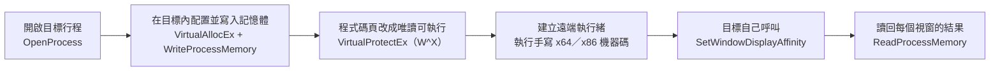
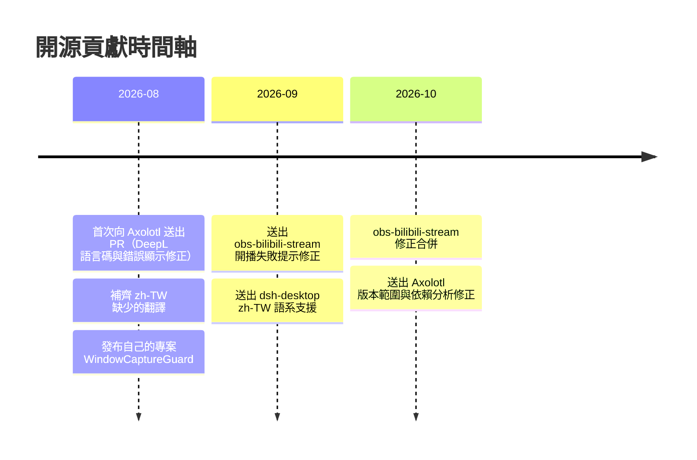

  

  
  
  

## 👋 關於我

- 繁體中文（zh-TW）使用者，主要投入開源專案的**軟體在地化（i18n / L10n）**與**翻譯管線**。
- 平常寫 **Rust** 與 **TypeScript**，也會用 **C#** 寫 Windows 小工具。
- 習慣從實際遇到的問題出發：先在 issue 寫清楚重現步驟，再送 PR 修正，並盡量附上測試。

## 🧰 技能

  

| 領域 | 內容 |
| --- | --- |
| 軟體在地化 | zh-TW 台灣用語規範、OpenCC `s2twp` 轉換、語系檔補齊與去重、新舊條目並存不覆寫 |
| 翻譯管線 | DeepL / Google / AI 供應商整合、語言碼對照（source 與 target 的變體規則不同）、批次容錯、錯誤訊息可見化 |
| 開發 | Rust（Win32 / egui）、TypeScript、C#、C++（CMake）、Git / GitHub Actions |

## 📦 自己的專案

### [WindowCaptureGuard](https://github.com/PZW152/WindowCaptureGuard)

在 Windows 上把指定的應用程式從螢幕擷取中隱藏（OBS、Teams、Zoom、系統截圖），但自己畫面上仍正常顯示 ——
直播或分享螢幕時，可以藏掉聊天視窗、私訊、密碼管理器這類不想被拍到的內容。

Windows 的 `SetWindowDisplayAffinity` 只允許「擁有該視窗的行程」自己呼叫，外部呼叫一律 `ERROR_ACCESS_DENIED`。
這個工具的做法是反過來讓目標行程自己呼叫：

2026-10 從 C# / WinForms **整個重寫成 Rust**：手寫注入酬載改用單一遠端執行緒處理多個視窗、
參數區與程式碼分頁（W^X）、明確校正堆疊對齊；介面改成自繪的 egui，含深淺主題、
自繪標題列與內嵌 Inter / Noto Sans TC 字型。

單一免安裝 `.exe`、內建繁體中文／简体中文／English 介面、支援 64 與 32 位元應用。

> 詳細功能、限制與原理：[README](https://github.com/PZW152/WindowCaptureGuard#readme)

## 🤝 開源貢獻

### [Mystic-Stars/Axolotl](https://github.com/Mystic-Stars/Axolotl) — 開源跨平台 Minecraft 啟動器

主要處理 **zh-TW 語系**與**翻譯功能**，以下已合併進 `main`：

| PR | 內容 | 合併 |
| --- | --- | --- |
| [#354](https://github.com/Mystic-Stars/Axolotl/pull/354) | 設定頁直接顯示 DeepL API 的實際錯誤（400 / 403 / 456），方便使用者自行排查 | 2026-08-22 |
| [#355](https://github.com/Mystic-Stars/Axolotl/pull/355) | 修正 DeepL 語言碼對照：zh-TW → `ZH-HANT`，並規範化地區碼 | 2026-08-22 |
| [#356](https://github.com/Mystic-Stars/Axolotl/pull/356) | 搜尋描述翻譯改為分批執行，單一批次失敗不再拖垮整頁 | 2026-08-22 |
| [#363](https://github.com/Mystic-Stars/Axolotl/pull/363) | 補齊 zh-TW 缺少的翻譯（1,016 + 141 條），以 OpenCC `s2twp` 轉換、不覆寫既有條目 | 2026-08-23 |
| [#365](https://github.com/Mystic-Stars/Axolotl/pull/365) | 搜尋描述翻譯改為跟隨設定中的目標語言，不再固定 zh-CN | 2026-08-23 |
| [#379](https://github.com/Mystic-Stars/Axolotl/pull/379) | 修正日誌預覽在多字元字串上切片造成 panic、翻譯完成後啟動器閃退 | 2026-08-23 |
| [#380](https://github.com/Mystic-Stars/Axolotl/pull/380) | 從 MANIFEST 解析 Forge 的佔位版本號 | 2026-08-24 |
| [#399](https://github.com/Mystic-Stars/Axolotl/pull/399) | 修正 DeepL `source_lang` 使用地區變體造成的 HTTP 400，搜尋描述翻譯統一走 `auto` | 2026-08-26 |

審查中：[#695](https://github.com/Mystic-Stars/Axolotl/pull/695) `A.B.x` 通配版本範圍誤判 ·
[#696](https://github.com/Mystic-Stars/Axolotl/pull/696) 依賴分析重複計算同一 Mod ·
[#698](https://github.com/Mystic-Stars/Axolotl/pull/698) Python traceback 棧幀高亮 ·
[#699](https://github.com/Mystic-Stars/Axolotl/pull/699) 跨 `await` 持有 DashMap 分片守衛 ·
[#702](https://github.com/Mystic-Stars/Axolotl/pull/702) 搜尋高亮與行內高亮衝突

### [anywhere-labs/dsh-desktop](https://github.com/anywhere-labs/dsh-desktop)

- [#1284](https://github.com/anywhere-labs/dsh-desktop/pull/1284) 新增繁體中文（zh-TW）語系支援 — 審查中

### [Zarosmm/obs-bilibili-stream](https://github.com/Zarosmm/obs-bilibili-stream) — OBS 的 Bilibili 直播外掛

- [#39](https://github.com/Zarosmm/obs-bilibili-stream/pull/39) 開播失敗時不再彈出空白提示框，並加強回應解析 — 已合併
- [#42](https://github.com/Zarosmm/obs-bilibili-stream/pull/42) macOS bundle id 與 metainfo 版本修正 — 審查中
- [#43](https://github.com/Zarosmm/obs-bilibili-stream/pull/43) 網路請求非同步化，避免阻塞 OBS 介面執行緒 — 審查中

### 回報的 issue

- Axolotl：[#353](https://github.com/Mystic-Stars/Axolotl/issues/353) DeepL HTTP 400 重現 ·
  [#410](https://github.com/Mystic-Stars/Axolotl/issues/410) DeepL 翻譯不穩定 ·
  [#697](https://github.com/Mystic-Stars/Axolotl/issues/697) ·
  [#700](https://github.com/Mystic-Stars/Axolotl/issues/700) ·
  [#701](https://github.com/Mystic-Stars/Axolotl/issues/701) 連線隧道殘留 socket
- LocalSend：[#3576](https://github.com/localsend/localsend/issues/3576) Windows MSIX 啟動項問題

## 🗓 貢獻時間軸

## 📊 GitHub

  
  

## 📬 聯絡

- GitHub：[@PZW152](https://github.com/PZW152) — 有 zh-TW 在地化或翻譯管線相關的需求，歡迎直接開 issue 找我。

  

