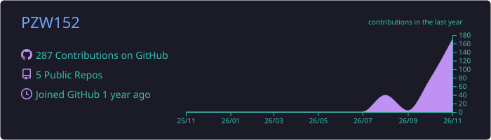
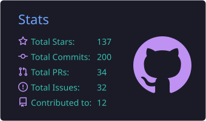
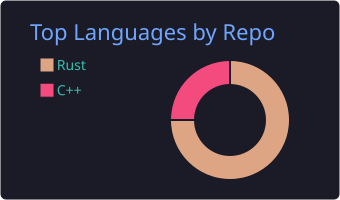

  

  

  <b>程式小白的 AI 許願編程實驗室</b> 
  沒有程式設計或相關技術的知識基礎，主要靠 <b>Codex、Claude 與 DeepSeek Harness</b> 進行「許願編程」。 把想做的功能說出來，讓 AI 協助把想法變成工具。  
  <a href="https://github.com/PZW152?tab=repositories">所有專案</a> &nbsp; / &nbsp;
  <a href="https://github.com/PZW152/obs-kaibo/releases/latest">Kaibo 下載</a> &nbsp; / &nbsp;
  <a href="https://github.com/PZW152/one-click-eu-lord/releases/latest">歐爺下載</a>

### 🤖 AI 協作工具

  
  
  

### 🧰 專案使用的技術

以下圖示代表專案用到的技術，不代表本人已熟練掌握。

  

### 🚀 精選專案

<table>
<tr>
<td width="50%" valign="top">

#### [Kaibo 開播](https://github.com/PZW152/obs-kaibo)

**在 OBS 裡，一鍵開播 Bilibili。**

掃碼登入、修改標題與分區、自動設定推流，以及斷流提醒。提供簡中、繁中與英文介面。

`C++` `OBS Studio` `Windows`

</td>
<td width="50%" valign="top">

#### [一鍵轉生歐爺](https://github.com/PZW152/one-click-eu-lord)

**Windows 11 的 EU/EEA 政策工具。**

純 Rust 實作，提供政策差異檢視、選擇性套用、狀態驗證與還原，搭配復古未來風 GUI。

`Rust` `Windows 11` `EU / EEA`

</td>
</tr>
</table>

### 📊 GitHub 活動

  
  
  

圖卡每日自動更新；語言分布反映專案組成，不代表技能熟練度。

### 🐍 貢獻軌跡

<picture>
  <source media="(prefers-color-scheme: dark)" srcset="https://raw.githubusercontent.com/PZW152/PZW152/main/assets/contributions/snake-dark.svg">
  <source media="(prefers-color-scheme: light)" srcset="https://raw.githubusercontent.com/PZW152/PZW152/main/assets/contributions/snake.svg">
  
</picture>

  發現問題或有功能建議？歡迎到對應專案開 Issue。

