  

  
  

## 代表作

### [Sapling Launcher](https://github.com/PZW152/sapling) 🌱

**打開就能玩的 Minecraft 啟動器。** 一個約 10 MB 的 exe，正版登入，Fabric、Quilt、NeoForge、Forge，內建 Modrinth 模組和整合包，崩潰時用白話告訴你是哪個模組的問題。

`Rust` `Tauri 2` `React` `TypeScript`

<table>
<tr>
<td width="50%" valign="top">

### [一鍵轉生歐爺](https://github.com/PZW152/one-click-eu-lord)

**Windows 11 的 EU/EEA 政策工具。** 166 KB 的單一 exe，不用執行環境，可完全還原。

`Rust` `Windows 11`

</td>
<td width="50%" valign="top">

### [Kaibo 開播](https://github.com/PZW152/obs-kaibo)

**在 OBS 裡一鍵開播 Bilibili。** 掃碼登入、修改標題與分區、自動設定推流、斷流提醒。

`C++` `OBS Studio`

</td>
</tr>
</table>

## 怎麼做出來的

我沒有程式設計背景。我負責想清楚要什麼、試用、挑毛病、做決定，程式由 AI 協作完成。這套做法我叫它**許願編程**。

  

  

這是專案的技術組成，不是我的技能清單。

## 開源足跡

  
  

<picture>
  <source media="(prefers-color-scheme: dark)" srcset="assets/contributions/snake-dark.svg">
  <source media="(prefers-color-scheme: light)" srcset="assets/contributions/snake.svg">
  
</picture>

  發現問題或有功能建議？歡迎到對應專案開 Issue。

